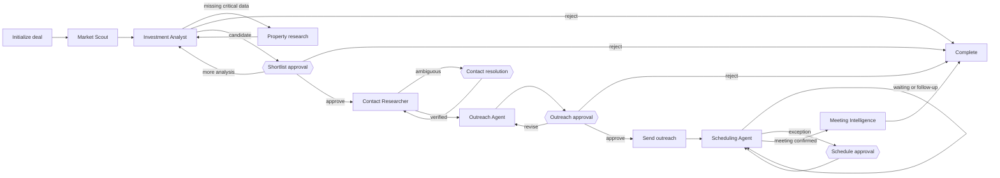

# LangGraph workflow design

## 1. Design rule

The orchestrator controls sequencing. Specialist agents never invoke other agents directly. Each node reads the shared `DealState` and returns a small, validated state update.

The checkpointer is dependency-injected. Tests use `InMemorySaver`; local durable
runs use `SqliteSaver` through `open_sqlite_graph`. A stable `thread_id` identifies
one deal history across application restarts. The SQLite connection is owned by a
context manager and the graph must only be invoked while that context is open.

For the MVP, one graph thread represents one property. The discovery layer may start many independent threads later. This keeps each property's checkpoints, approvals, errors, and audit history isolated.

The current executable slice continues through contact research. The contact service is injected behind a protocol: fixtures are used locally, while a future enrichment provider can be added without changing graph routing. A single result with confidence of at least 0.8 is selected automatically; no results stop for research; multiple or weaker results require human resolution.

The Market Scout's listing source is also injected behind a protocol. The local UI
uses `KeenableListingSearchService` for live public-web discovery; offline tests use
`FixtureListingSearchService`. Keenable results enter the graph only after
deterministic normalization verifies purchase intent, target location, source URL,
and asking price. The original URL, retrieval timestamp, and snippet are retained
as evidence.

After a contact is selected, the Outreach Agent creates a draft but has no sending tool. The draft's contact ID and email must match the selected contact. LangGraph then interrupts on the exact recipient, subject, and body; the approved final text and approval record are persisted before the workflow completes.

The approved draft is passed to a separate `EmailGateway` tool boundary. The current gateway is memory-only and sends nothing externally. The send node derives a stable SHA-256 idempotency key from the workflow ID and exact approved message, so replaying a node returns the original receipt instead of creating another message.

After the fake send, `wait_for_reply` creates a durable interrupt. On resume, the
reply sender must match the selected contact. The Scheduling Agent classifies the
reply without parsing its prose in routing code. A proposed time inside the
workflow's `SchedulingPreferences` is booked through an injectable, memory-only
`CalendarGateway`; an outside time pauses at `schedule_approval`. Calendar booking
uses its own stable idempotency key. A confirmed meeting advances to
`meeting_intelligence`. Its provider-neutral briefing service receives only the
validated deal state and returns a `MeetingBrief`. The deterministic implementation
is the offline default; an optional Nebius adapter uses structured output.

## 2. Graph nodes

| Node | Type | Responsibility | Possible next step |
| --- | --- | --- | --- |
| `initialize_deal` | deterministic | Validate criteria and initialize identifiers | `market_scout` |
| `market_scout` | agent + tools | Discover, normalize, deduplicate, and filter listings | `investment_analyst`, `complete` |
| `investment_analyst` | agent + calculator/RAG | Calculate metrics, assess risk, and recommend a route | routing function |
| `request_more_property_data` | agent + tools | Fill material information gaps | `investment_analyst`, `human_review` |
| `shortlist_approval` | human interrupt | Approve, reject, or request more analysis | routing function |
| `contact_researcher` | agent + tools | Find and verify contacts | routing function |
| `contact_resolution` | human interrupt | Select or reject ambiguous contacts | `outreach_agent`, `complete` |
| `outreach_agent` | agent | Draft initial outreach | `outreach_approval` |
| `outreach_approval` | human interrupt | Approve, edit, or reject exact message | routing function |
| `send_outreach` | deterministic tool action | Fake-send one idempotent approved message | `wait_for_reply` |
| `wait_for_reply` | durable interrupt | Accept and validate one inbound broker reply | `scheduling_agent` |
| `scheduling_agent` | agent + policy | Classify the reply and create a proposed meeting | routing function |
| `schedule_approval` | human interrupt | Approve or reject an exceptional booking | `book_meeting`, `complete` |
| `book_meeting` | deterministic tool action | Create one idempotent fake calendar event | `meeting_intelligence` |
| `meeting_intelligence` | agent | Produce a validated broker-call brief | `END` |
| `handle_error` | deterministic | Record failure and decide retry, review, or stop | failed node, `human_review`, `complete` |
| `complete` | deterministic | Mark the terminal outcome | `END` |

## 3. Main flow



## 4. Investment routing rules

Routing should be deterministic after the analyst returns a validated result:

1. If critical fields are missing and the research budget is not exhausted, route to `request_more_property_data`.
2. If critical fields remain missing after the configured limit, route to human review.
3. If the recommendation is `reject`, archive the candidate.
4. If the recommendation is `review` or `shortlist`, pause at `shortlist_approval`.
5. Never derive routing by parsing prose. Use the `AnalysisRecommendation` enum.

## 5. State-update pattern

A node should return only the fields it owns:

```python
def investment_analyst(state: DealState) -> dict:
    analysis = analyst.analyse(state["property"], state["criteria"])
    return {
        "analysis": analysis,
        "current_stage": WorkflowStage.ANALYSIS,
        "audit_events": [make_event("investment_analyst", "completed")],
    }
```

This pattern reduces accidental overwrites and makes node behavior easy to test.

## 6. Error policy

- Validation or permanent input error: pause for human correction.
- Rate limit or temporary service failure: retry with bounded exponential backoff.
- Missing optional data: continue and record the limitation.
- Missing critical data: use the research route or human review.
- External side-effect uncertainty: inspect the idempotency record before retrying.
- Exhausted retry budget: pause instead of silently skipping the node.
